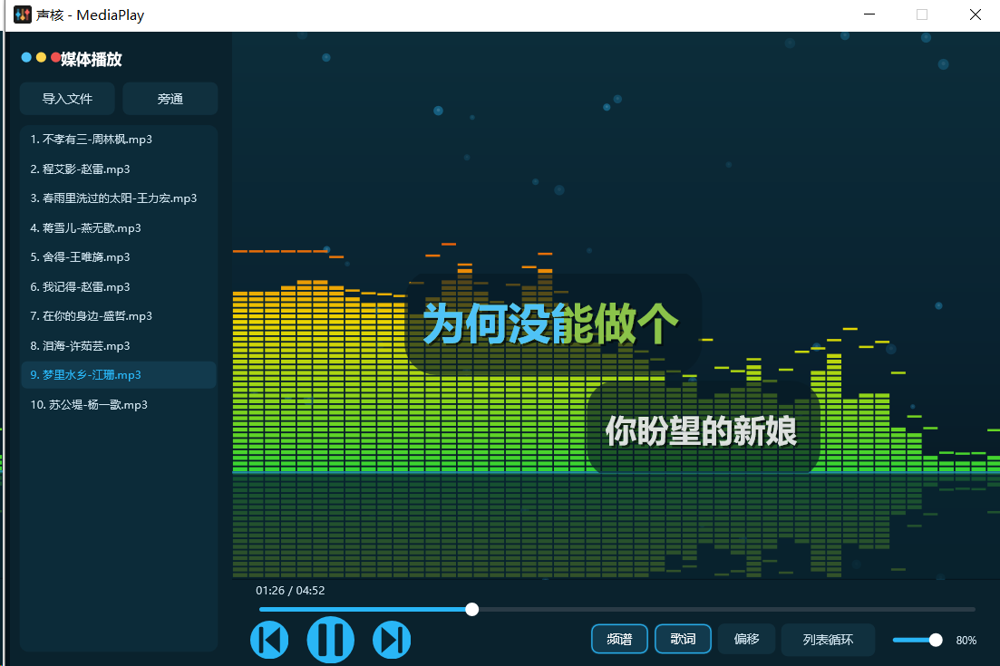

# MediaPlay — VST3 Music Player Plugin



赛博朋克风格的音频播放器插件：既是 **VST3 效果器**（可加载进 DAW / 机架），也是**独立播放器**（Standalone exe，双击即用）。

Cyberpunk-style music player: works as a **VST3 plugin** (for DAWs / rack hosts) and as a **standalone player** (Standalone exe).

## 功能特性 / Features

- 🎵 直读播放引擎：`processBlock` 内流式解码（Windows Media Foundation），支持 MP3 / M4A / AAC / FLAC / OGG / WAV / WMA 等，自动识别伪 MP3 扩展名的 MP4/AAC 容器
- 📊 LED 分段频谱可视化：底绿→中黄→顶红渐变 + 峰值帽 + 基线倒影（参考 ZenFile 播放器）
- 🎤 KTV 歌词：加载音频同目录同名 `.lrc`，支持**增强逐字格式**（`<mm:ss.xx>` 按字渐染）与普通逐句格式；双行显示（当前行/下一行）、天蓝渐染已唱、白色未唱
- ⏱ 歌词偏移微调：点击「偏移」弹出参考线，上拉提前 / 下拉延后（±10s），按歌曲记忆并持久化
- 🎛 播放管理：多文件播放列表、四种播放模式（顺序 / 列表循环 / 单曲循环 / 随机）、进度条拖动 seek、频谱/歌词开关
- 💾 状态持久化：播放列表、当前曲目、播放位置、播放模式、音量、各开关全部随宿主保存恢复

## 二进制下载 / Downloads

见 [Releases](../../releases)：`MediaPlay-Standalone-win64.zip`（独立播放器 exe）与 `MediaPlay-VST3-win64.zip`（VST3 插件）可分开独立使用。

## 从源码构建 / Build from Source

1. 克隆本仓库
2. 下载 [JUCE 8.0.15](https://github.com/juce-framework/JUCE/releases/tag/8.0.15)，解压到 `ThirdParty/juce-8.0.15`（目录内应直接包含 `modules/`、`CMakeLists.txt`）
3. Windows + Visual Studio 2022（MSVC v143 + Windows SDK 10），运行：

```bat
build.bat
```

产物位于 `build/VstMediaPlayer_artefacts/Release/`：`Standalone/MediaPlay.exe` 与 `VST3/MediaPlay.vst3`（构建后自动复制到系统 VST3 目录）。

## 应用图标 / App Icon

`Assets/MediaPlay-icon.png`（1024 主图）、`Assets/MediaPlay-icon-small.png`（64 简化图）、`Assets/MediaPlay.ico`（16–256 多尺寸 Windows 图标）。CMake 通过 `ICON_BIG` / `ICON_SMALL` 自动把图标嵌入 `MediaPlay.exe` 及 VST3 包；改设计后运行 `python Assets/generate_icon.py` 重新生成。

The Windows executable icon lives in `Assets/`; regenerate it with `python Assets/generate_icon.py`.

## 使用说明 / Usage

- **Standalone**：直接运行 exe，注意音频输出设备选择正确的扬声器
- **VST3**：将插件加载到 DAW / 机架的任意音频轨道（Fx 类效果器，默认透传输入，不影响通道声音）
- **歌词**：把与音频同名的 `.lrc` 放在同一目录即可自动加载

## 许可 / License

仅供学习交流使用。
